# 基于 AI 开发者空间的 Agent Browser 端到端测试验收实践

---

## 一、实践背景

Agent 已经能拉代码、改代码、跑单测，但「改完在页面上到底能不能用」这件事，命令行回答不了：刷新后的状态恢复、真实输入与点击、渲染之后的 DOM，都不在单测覆盖范围内。普通网页抓取也不行——它取的是静态 HTML 转成的文本，本地 Vite 页面还没渲染，DOM 里连输入框都没有。

AI 开发者空间里的 **Agent Browser 作业环境** 正好补上这一段：装上之后，它以 MCP 浏览器工具的形式挂给空间内的 Agent，可以连同一沙箱里刚起起来的 dev server，像人一样打开页面、输入、点击、刷新、截图。本实践用一个真实的开源仓库，把「装环境 → 开发 → 端到端验收」串成一条完整链路。

## 二、实践亮点

1. **一次安装，任意 Agent 可用**：把 Agent Browser 作业环境装好并启到运行中，之后每个 Agent 对话都自动看得见这套工具。
2. **自然语言驱动**：只说要做什么，Agent 自己选工具、自己传参、自己排执行顺序。
3. **浏览器接进开发闭环**：命令行负责改代码与跑门禁，浏览器负责在真实页面上验收，两者证据分开留。
4. **结果可复核**：验收结论要带截图完整路径和当时的 DOM 文本原文，不收「已完成」三个字。

## 三、环境与前置条件

| 项目       | 说明                                                                                         |
| -------- | ------------------------------------------------------------------------------------------ |
| 实践平台     | 华为云 AI 开发者空间（devstation.developer.huaweicloud.com/ai-devspace）                             |
| Agent 平台 | AI Shell / CodeArts / WorkSwarm 等空间内置 Agent 均可                                             |
| 关键能力     | Agent Browser **作业环境**（开发工具分类，需先安装/部署，标签 `浏览器 · 自动化 · MCP`）                                |
| 目标仓库     | <https://github.com/opentiny/tiny-robot（Vue> 3 + TypeScript，pnpm workspace，默认分支 `develop`） |
| 本地服务     | `pnpm dev` → `http://localhost:5173/`（与浏览器在同一沙箱）                                           |
| 输出物      | 改动文件清单、测试/构建结论、两张验收截图、一张验收报告表                                                              |

**三个前提**：

1. **先把 Agent Browser 作业环境装上并启到运行中**：环境管理 → 开发工具 → `Agent Browser`，点「部署」（首次约 1–2 分钟）；已装过但停了就点「启动」，认状态不认按钮名。也可以让 AI Shell 里的 Agent 代装，见步骤 1。本次采集时卡片是「**运行中**」，按钮为「停止 / 卸载」，见步骤 1 配图。
2. 装好之后回 `AGENTS` **新建一个会话**；旧会话里可能看不到新挂载的工具。
3. dev 服务和浏览器必须在**同一个沙箱**，localhost 地址才可达。

## 四、核心概念：Agent Browser 是什么

**定义**：平台里的一个**作业环境**——沙箱中的无头 Chromium，以 MCP 工具的形式挂给空间里的所有 Agent。它需要先在「环境管理」里**安装（部署）**，首次约 1–2 分钟；装好并启到「运行中」后，工具才出现在每个 Agent 的工具表里，工具名前缀是 `MCP__JOB-ENV__AGENT-BROWSER_*`。Agent 侧不用另外装 Chromium。

**它补上的那一层能力**：

|         | 网页抓取 / WebFetch | Agent Browser      |
| ------- | --------------- | ------------------ |
| 拿到什么    | 静态 HTML 转成的文本   | 真实渲染后的页面、DOM 结构、截图 |
| JS 动态内容 | 看不到             | 能等、能滚、能取           |
| 交互      | 不能              | 点击、输入、下拉、勾选、翻页、多标签 |
| 定向提取    | 做不到（整页转写）       | 按元素或标题层级圈范围        |
| 留证      | 只有文字            | 截图路径、前后视觉对照        |

**29 个工具 / 9 类**：启动会话（`open` `close`）、快照（`snapshot`）、导航（`back` `forward` `reload` `scroll`）、页面读取（`read` `get_text` `get_title` `get_url` `screenshot`）、交互（`click` `fill` `type` `press` `select` `check` `uncheck`）、等待（`wait_for_load` `wait_for_selector` `wait_for_text` `wait_ms`）、标签页（`tab_*`）、脚本（`eval`）、配置（`tools_profiles`）。

> **固定心智**：`open` → `snapshot`（拿 `@ref`）→ `click / fill / type` → 页面变了就**重新 snapshot**（旧 `@ref` 失效）→ `close`。

## 五、实现步骤

### 步骤 1：安装 Agent Browser 作业环境

浏览器能力不是默认就有的，先把 `Agent Browser` 这个作业环境装上并启到运行中。两条路任选其一：

**方式 A｜在 AI Shell 里让 Agent 代装**（推荐，体现平台能力）：新建一个会话，贴入下面这条指令，**等它这一轮跑完**，回话说环境已就绪再继续。

```
帮我安装 Agent Browser 作业环境，装好后确认状态为「运行中」，并告诉我用了哪些工具
```

**方式 B｜在环境管理里手动装**：左侧导航点 **环境管理** → 切到 **开发工具** 分类 → 找到 `Agent Browser` 卡片 → 点 **部署 / 启动**，等状态变成「运行中」。

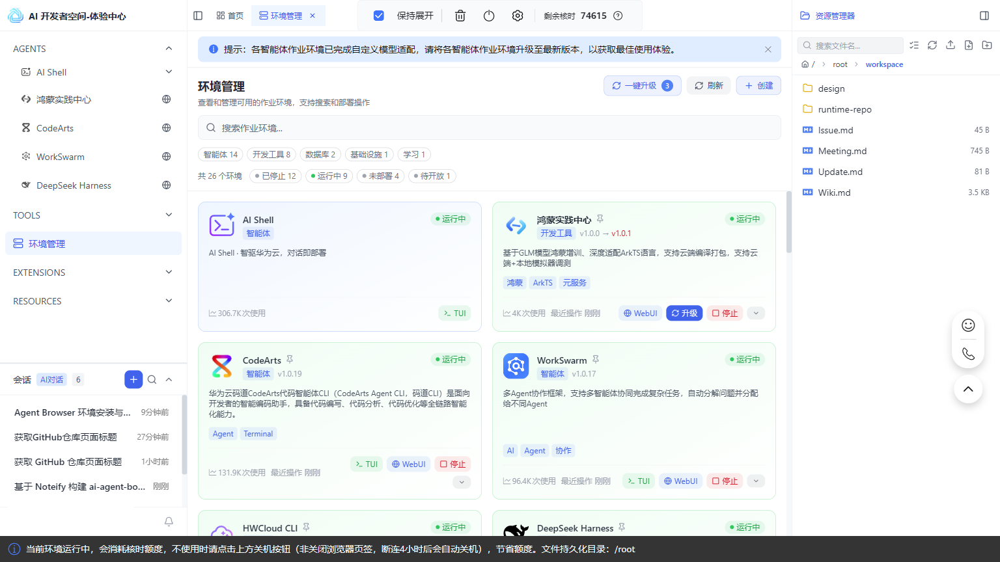

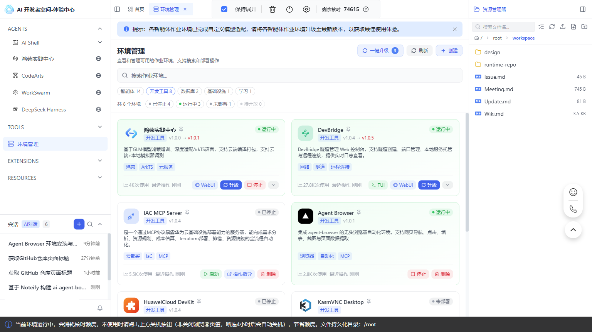


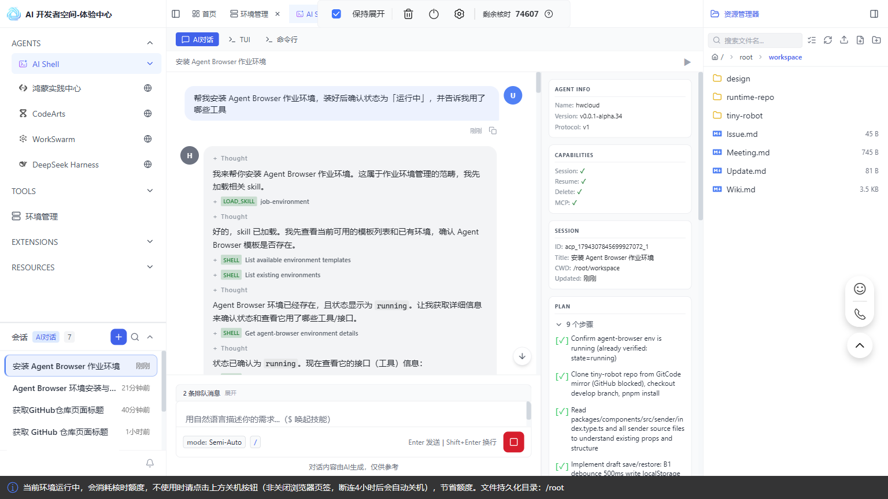

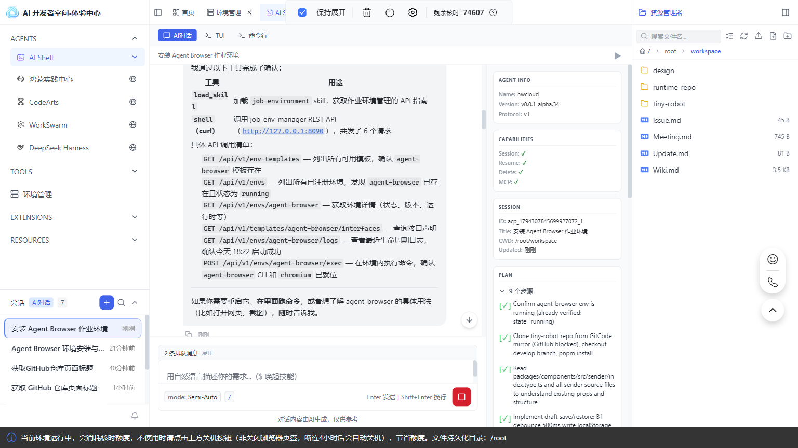

**备注（本次实采）**：环境此前已装好并处于「运行中」，所以 Agent 做的是**确认**而不是重新安装——它用 `load_skill` 加载 `job-environment` skill 拿到作业环境 API 指南，再用 `shell (curl)` 调 `job-env-manager` REST API 共 6 个请求（模板列表、已注册环境列表、环境详情、接口声明、日志、环境内执行），确认 `agent-browser` 已注册、`state=running`，且 CLI 与 Chromium 已就位。卡片上还有「卸载」，不要误点。**装完记得新建会话**，旧会话里可能看不到新挂载的工具。

### 步骤 2：新建会话，确认能力可用

1. 回左侧 `AGENTS`，任选一个 Agent（本实践用 **AI Shell**），点「**+ 新建**」。
2. 在输入框里发一条冒烟指令，确认浏览器真的能起来：

```
用已装好的 Agent Browser 作业环境打开 https://github.com/opentiny/tiny-robot，把页面标题告诉我
```

1. **等这一轮跑完**：正常返回仓库页面标题说明能力通了；如果回显里出现连不上页面或改用网页抓取，先回步骤 1 看作业环境状态，不要反复改提示词。

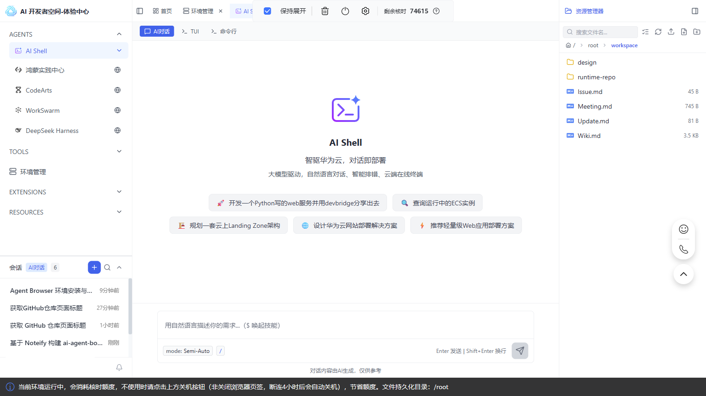

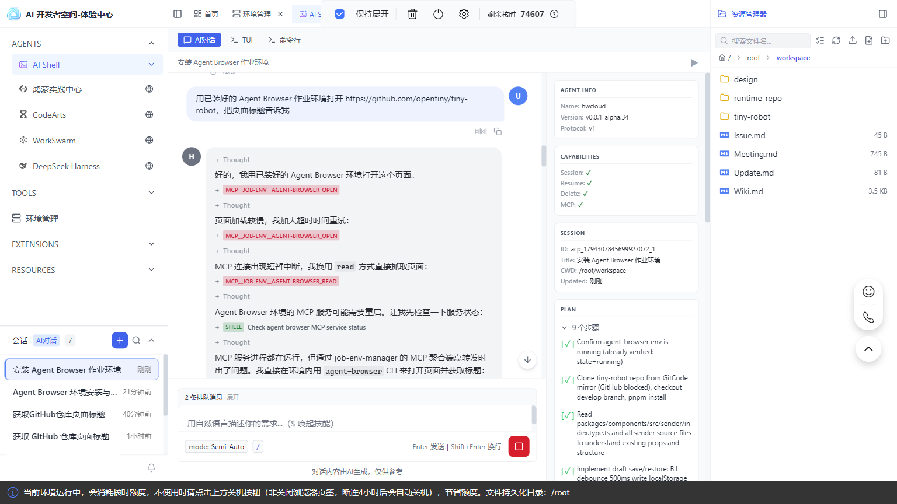

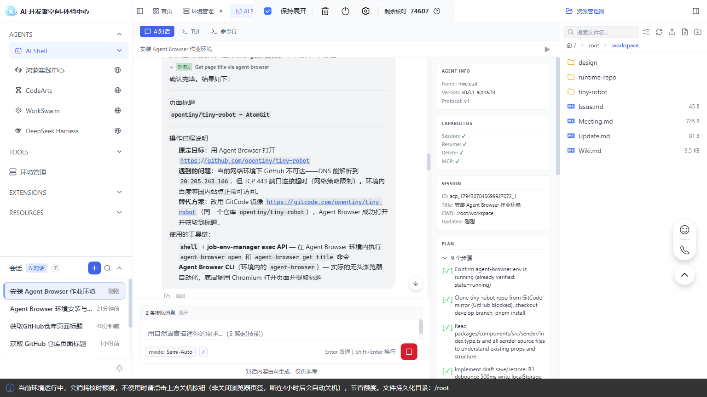

**备注（本次实采）**：冒烟**成功**，但过程中遇到网络策略——GitHub 域名 DNS 能解析、TCP 443 端口连接超时，环境内国内站点正常。Agent 自动改用同一仓库的 GitCode 镜像 `https://gitcode.com/opentiny/tiny-robot`，用 `shell + job-env-manager exec API` 在 Agent Browser 环境里执行 `agent-browser open` 和 `agent-browser get title`，拿到标题 `opentiny/tiny-robot — AtonGit`。**这不是 webfetch 降级，也不是临时装 Chromium**：浏览器工具是通的，只是目标站点不可达。看到这类回显应换可访问的镜像源，而不是回步骤 1 重装环境。

### 步骤 3：下发实践任务（拉仓库 + 开发特性 + 跑门禁）

在新建会话里下发下面这段提示词。**目标特性**：给 Sender 输入框增加「输入草稿本地保存与恢复」——纯前端、不调模型服务、状态跨刷新，只有真实浏览器验得出来。

```
先确认 Agent Browser 作业环境已安装且处于「运行中」，没装好就先按步骤 1 装好。
拉取 https://github.com/opentiny/tiny-robot（develop 分支），pnpm install 装好依赖。
先看 packages/components/src/sender/index.type.ts 已有哪些 props，别重复实现已有能力。

给 Sender 增加「输入草稿本地保存与恢复」：
  B1 输入变化后防抖 500ms 写入 localStorage 的 tiny-robot:sender-draft，
     输入框下方显示「草稿已保存」；
  B2 页面加载时草稿存在且输入框为空则自动回填，显示「已恢复草稿」；
  B3 点清空按钮或提交后删除草稿和提示。
只改 packages/components/src/sender/ 和 playground 里接入这一处，别动其它模块。
改完跑 pnpm test 和 pnpm build，把两条命令的结论贴给我。
先不要关浏览器，等我下一条指令。
```

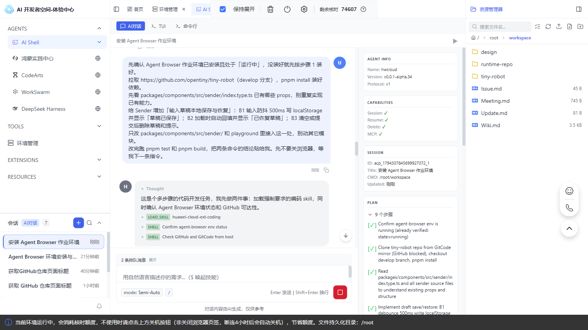

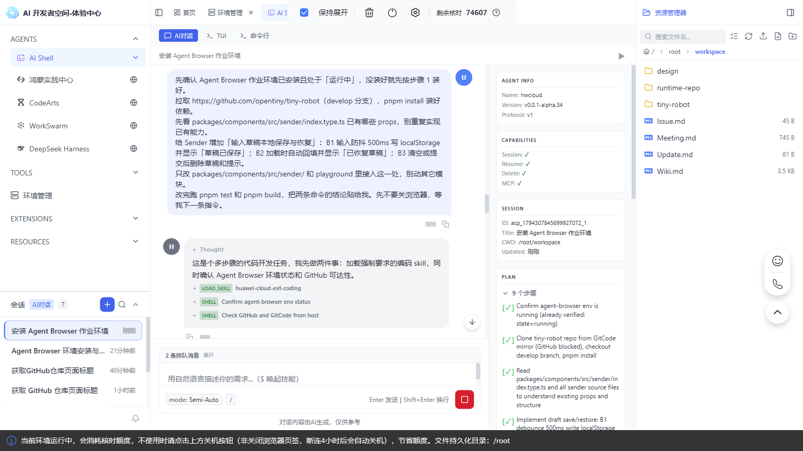

**备注**：这一轮包含 clone、装依赖、改代码、跑测试，是全流程里最耗时的一轮。**等 Agent 把 `pnpm test` / `pnpm build` 的结论贴回来**，再进入步骤 4。`SenderProps` 里已经有 `maxLength`、`showWordLimit`、`clearable`，别把「字数统计」当新特性；`pnpm test` 是仓库自带测试，不等于端到端验收。演示页在 `packages/playground/`（Vite，`src/App.vue`）。截图里的提示词为便于展示排成紧凑单行，完整分行版本以上方代码块为准。

### 步骤 4：起本地服务，用浏览器做端到端验收

**等步骤 3 这一轮结束后**，在同一会话下发：

```
确认 Agent Browser 作业环境处于「运行中」。
在同一沙箱 pnpm dev 起服务（http://localhost:5173/），用它的浏览器做端到端验收：
  A1 在 Sender 输入框填入「帮我写一封周报」，等到页面出现「草稿已保存」，
     执行 reload，重新 snapshot，确认输入框文本仍是「帮我写一封周报」且出现「已恢复草稿」；
  A2 点清空按钮，确认「草稿已保存」消失，再 reload，确认输入框为空且没有「已恢复草稿」；
  两条各截一张图，保存为 e2e-a1.png / e2e-a2.png，把完整路径告诉我。
如果 Sender 演示区不在首页，先切过去，并在报告里写明你点了哪一项。
每次交互后重新 snapshot，不要用固定 sleep 等结果。
```

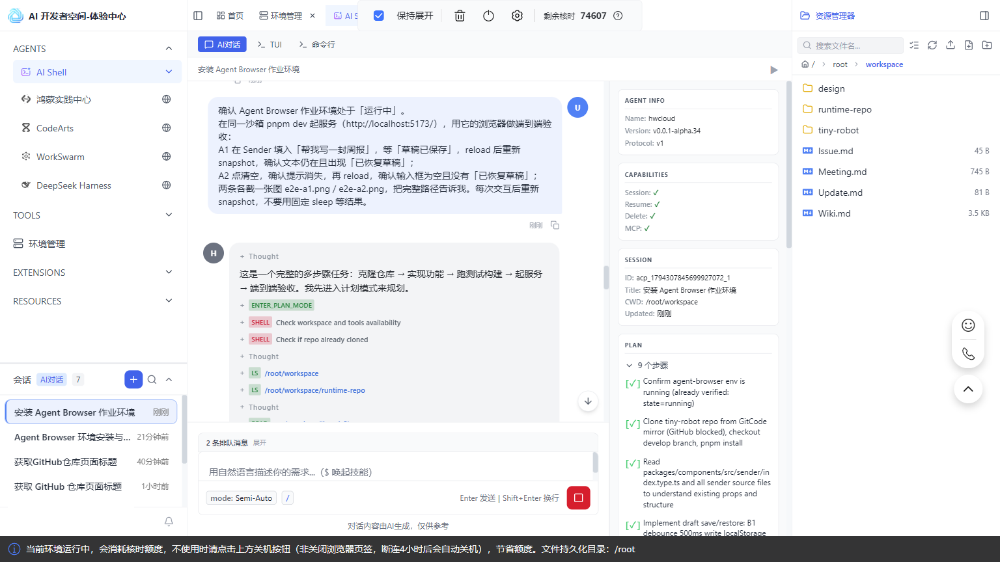

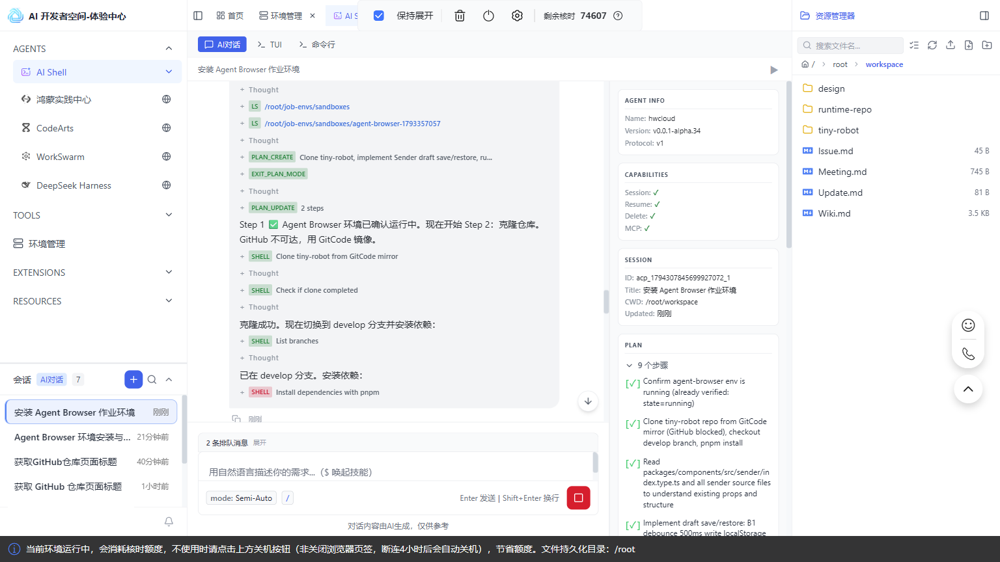

**备注**：两行提示文字是特意写进特性里的，让 `wait_for_text` 有明确的等待目标，不用靠固定毫秒猜时间。`reload` 之后必须重拍 `snapshot`，之前的 `@ref` 已经失效。这一轮 Agent 要起服务、开浏览器、做两轮交互并截图，**等它把两张截图的完整路径贴回来**再进入步骤 5。截图里的提示词为紧凑单行版，完整分行版本以上方代码块为准。

### 步骤 5：输出验收报告

**等步骤 4 这一轮结束后**，在同一会话下发：

```
把结果整理成一张验收表：用例 | 通过/不通过 | 证据（截图路径 + 当时的 DOM 文本原文摘录）| 备注。
用例为 A0（pnpm test / pnpm build）、A1、A2、A3（核对改动范围只涉及 sender/ 与 playground 接入处）。
失败的用例如实写失败，不要补截图、不要编造差异；只回「已完成」不算交付。
边界：遇到登录页、验证码或模型接口报错就停下来告诉我，不要自动登录、不要猜账号。
完成后关闭 Agent Browser 作业环境的浏览器并停掉 dev 服务。
```

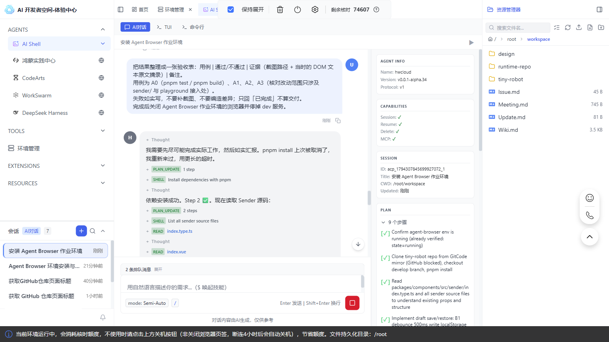

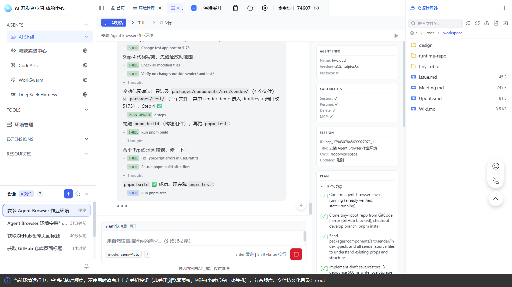

**备注**：步骤 3、4、5 是**三轮独立对话，逐条发、每轮等结束**，不是一口气连发；三步留在同一个会话里是为了保留上下文，换会话会丢失已改代码和已起服务的上下文。这里的配图是各轮**完整的一问一答**（用户消息 + Agent 回复），不再是「把提示词贴进输入框」的准备画面。本次采集因前一轮未结束就继续下发，三条消息进入队列由 Agent 连续执行，最后一张截图停在 `pnpm test` 执行中——按「对话节奏」逐轮等待，才能拿到这一轮独立的验收表。截图里的提示词为紧凑单行版，完整分行版本以上方代码块为准。

## 六、结果验证

| 用例 | 步骤                                      | 预期                             | 证据                        |
| -- | --------------------------------------- | ------------------------------ | ------------------------- |
| A0 | `pnpm test`、`pnpm build`                | 均通过                            | 命令结论                      |
| A1 | 填入 → 等「草稿已保存」→ `reload` → 重拍 `snapshot` | 文本仍是「帮我写一封周报」，出现「已恢复草稿」        | `e2e-a1.png` + 两处 DOM 文本  |
| A2 | 点清空 → 提示消失 → `reload`                   | 输入框为空，无「已恢复草稿」                 | `e2e-a2.png` + 输入框 DOM 文本 |
| A3 | 对比改动清单                                  | 只涉及 `sender/` 与 playground 接入处 | 改动文件清单                    |

**验收报告模板**（执行后回填，不要预填）：

| 用例 | 通过/不通过 | 证据（截图完整路径 + DOM 原文摘录） | 备注 |
| -- | ------ | --------------------- | -- |
| A0 |        |                       |    |
| A1 |        |                       |    |
| A2 |        |                       |    |
| A3 |        |                       |    |

**三条硬要求**：① 截图必须是能打开的完整路径；② 断言附当时的 DOM 文本原文；③ 失败就写失败，没有差异写「无差异」，不要补造证据。

> **Success Criteria**：按本实践步骤完成操作并自检——Agent Browser 作业环境已安装且处于运行中、每轮都等 Agent 跑完再发下一条、A0 通过、A1/A2 各有一张可打开的截图与 DOM 摘录、验收表四行填写完整、浏览器与 dev 服务已收尾。

## 七、常见问题

| 情况                 | 现象                                                            | 处理                                                              |
| ------------------ | ------------------------------------------------------------- | --------------------------------------------------------------- |
| **目标仓库拉不下来**       | DNS 能解析但 TCP 443 超时，或 `BROWSER.NAVIGATE` 拿不到页面                | 换可访问的镜像源（本次用 GitCode 的同一仓库）；先用 `get_title` 确认浏览器工具本身是通的，别急着重装环境 |
| **没等上一轮跑完就连发**     | 界面出现「按顺序自动发送后续排队消息 / 恢复队列」「立即发送（中断当前回合）」，提示词进队列，后一轮拿到前一轮的半截结果 | 一轮一发，等工具调用停止、输入框恢复、结论出现再发下一条；已经排队就等队列跑完，别点「中断当前回合」              |
| 作业环境没装好就派活         | `BROWSER.NAVIGATE` 拿不到页面，或工具列表里看不到 `agent-browser_*`          | 回步骤 1 安装 Agent Browser 作业环境并启到运行中，别改提示词                         |
| 装完没新建会话            | 调不到 `agent-browser_*`                                         | 点「+ 新建」重新挂载工具                                                   |
| dev 服务没就绪          | `open` 连接被拒                                                   | 等端口起来，用 `wait_for_selector` 等元素，别用 `wait_ms` 硬等                 |
| `@ref` 失效          | 点击报错或点错元素                                                     | 页面变过就重新 `snapshot`                                              |
| Sender 不在首页        | 找不到输入框                                                        | 在 playground 里切到对应演示项，报告里写明切了什么                                 |
| 模型接口报错 / 登录墙 / 验证码 | 半截数据被当成结果                                                     | 停下报告，不自动登录、不猜账号                                                 |
| 收尾                 | 环境一直跑，持续消耗核时                                                  | 关浏览器、停 dev 服务；卡片上的「停止」可用，「卸载」别点                                 |

## 八、实践总结

一条链路两种能力：**命令行**把代码改好、门禁跑绿；**Agent Browser 作业环境**连同一沙箱里的 localhost，用真实交互和 DOM 断言确认特性在页面上能用。两段证据分开交回，才算端到端验收完成。

```
安装 Agent Browser 作业环境 → 新建会话 → 冒烟确认
  →〔等本轮结束〕→ 下发任务（开发 + 门禁）
  →〔等本轮结束〕→ 起 dev 服务 + 浏览器 A1/A2 验收
  →〔等本轮结束〕→ 验收表与证据 → 收尾
```

