# AI 开发者空间：aishell + codearts完成代码开发全流程

## 1. AI 开发者空间是什么

AI 开发者空间是一个运行在华为云上的在线开发环境。你打开浏览器，面对的是一个聊天框——你用自然语言告诉它你想做什么，它替你完成从写代码、启动服务、预览效果、分享端口、操作云资源到代码上传的全流程。

开发者空间主页如下图所示：

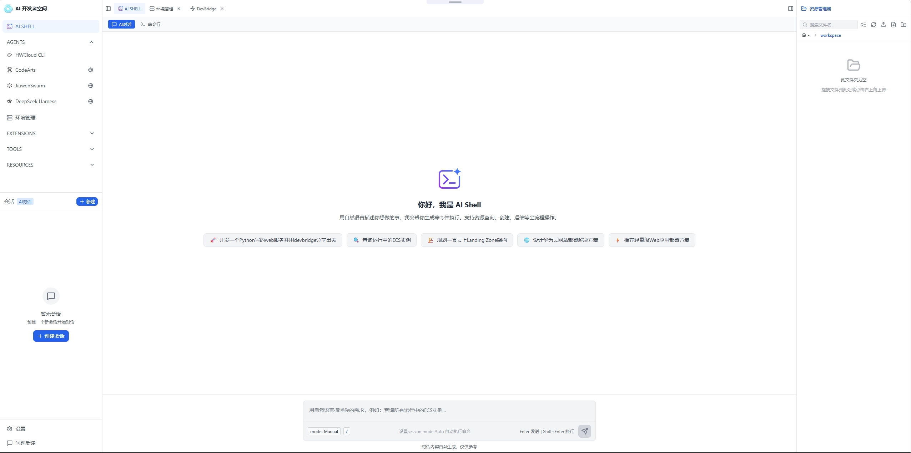

*上图展示了 AI 开发者空间的主页界面，核心就是一个聊天框，你用自然语言描述需求，它替你完成后续所有操作。*

传统开发中，光是"让一个项目跑起来"就需要：本地安装编程语言运行时、配置依赖管理工具、处理版本冲突、开放端口、配置反向代理、申请公网 IP、登录云控制台手动点选资源、再用 Git 客户端推送代码。每一步都可能卡住，每一步都要切换工具。AI 开发者空间把这些全部内置并串联起来，你只需要说话，它在后台完成所有操作，把结果交给你。

**适合谁用**：想快速验证想法的产品经理、不想折腾环境配置的开发者、需要操作华为云资源但不想记控制台路径的运维人员，以及任何想用一句话把想法变成可运行产品的人。

---

## 2. 一站式能力总览

从"我有个想法"到"代码上线存档"，AI 开发者空间覆盖以下完整链路：

| 步骤 | 你需要做的 | 开发者空间替你做的 |
|------|-----------|-------------------|
| 描述需求 | 说一句话："帮我做一个数据可视化大屏" | 自动生成项目代码、创建目录结构 |
| 安装依赖 | 什么都不用做 | 自动安装所需的框架、库、工具链 |
| 启动服务 | 什么都不用做 | 自动选择可用端口、启动 Web 服务 |
| 预览效果 | 点击返回的链接 | 生成可直接在浏览器打开的预览 URL |
| 分享给外部 | 说一句"帮我创建隧道分享端口" | 通过 DevBridge 生成公网可访问链接 |
| 操作云资源 | 说一句"帮我查一下有哪些 ECS" | 调用华为云 API，返回资源列表 |
| 上传代码 | 说一句"帮我传到 GitCode" | 扫码登录、建仓库、推送代码，一步到位 |

开发者空间的环境管理页面如下图所示，码道（CodeArts）、DevBridge 等核心组件都在其中：

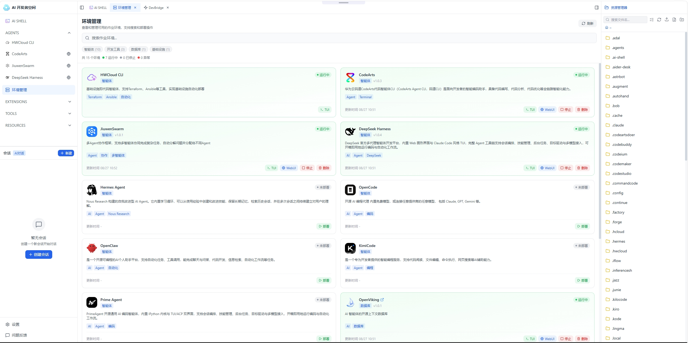

*上图展示了开发者空间的环境管理页面，码道（CodeArts）、DevBridge 等核心组件集成其中，一站式覆盖代码开发、预览、分享、云资源操作全流程。*

下面逐章展开每个能力。

---

## 3. 写代码

你想做一个网站、一个管理系统、一个 API 服务，或者一个数据可视化大屏——只需要用一句话描述需求，AI 开发者空间就会自动为你生成完整的项目代码。

它背后连接的是 CodeArts（码道）——华为云提供的 AI 编程助手。你不需要了解它是怎么连接的，只需要知道：你描述需求，它写代码。代码写完后，所需的依赖包（比如 Node.js 的 npm 包、Python 的 pip 包）也会自动安装，服务会自动启动。整个过程你不需要在本地装任何东西，不需要打开任何 IDE。

**你能让它做什么**：

| 项目类型 | 示例需求 |
|---------|---------|
| Web 网站 | "帮我做一个产品展示官网，首页带轮播图" |
| 管理系统 | "帮我写一个员工管理后台，支持增删改查" |
| API 服务 | "帮我做一个 RESTful API，提供用户注册登录接口" |
| 数据可视化 | "帮我做一个销售数据可视化大屏，用 ECharts" |
| 前端页面 | "帮我用 React 写一个待办事项应用" |
| 全栈应用 | "帮我做一个博客系统，前端 Vue 后端 Express" |

人工写代码需要打开编辑器、搭项目骨架、查文档、手写每一行、调试报错；在这里，你只管提需求，它把代码写好、依赖装好、服务跑起来，直接进入下一步。

---

## 4. 效果预览：写完立刻能看

代码写完后，AI 开发者空间会自动启动 Web 服务并生成一个预览 URL。你直接在浏览器里打开这个链接，就能看到运行效果——无论是一个网页、一个管理系统界面，还是一个数据大屏。

你不需要自己去配 nginx、做端口转发、或者折腾本地 hosts 文件。预览链接是华为云开发者空间自动生成的，格式类似于 `https://端口号-容器标识.workspace.developer.huaweicloud.com/`，只要你的开发空间在运行，这个链接就一直有效。

| 预览能力 | 说明 |
|---------|------|
| 自动启动 | 代码写完后自动检测可用端口并启动服务 |
| 即时访问 | 生成预览 URL，浏览器直接打开即可看到效果 |
| 持续可用 | 开发空间运行期间链接持续有效，可反复访问 |
| 无需配置 | 不需要手动配 nginx、端口转发、hosts 文件 |

看到效果后如果想改，直接在聊天里说"把首页颜色改成蓝色"或"加一个导出按钮"，它会修改代码并重新启动服务，刷新页面就能看到更新。

---

## 5. 端口分享：把开发中的服务分享出去

预览 URL 只有你自己能访问。如果你想把正在开发的服务分享给同事、客户或者其他设备——比如让同事看看 demo 效果、让手机端测试一下页面适配、或者接收外部系统的 webhook 回调——AI 开发者空间通过 DevBridge 开发隧道帮你实现。

**DevBridge 是什么**：华为云提供的开发隧道服务，能把开发者空间里运行的本地服务，通过华为云中继基础设施暴露成一个公网可访问的链接。外部用户不需要任何特殊工具，用浏览器打开链接就能访问。

| 能力 | 说明 |
|------|------|
| 一键创建隧道 | 说一句"帮我创建隧道分享 8080 端口"，自动完成全部配置 |
| 公网可访问 | 生成 `https://隧道ID-端口.区域-bridge.myhuaweicloud.com` 格式的公网链接 |
| 支持多端口 | 一个隧道可以同时分享多个端口 |
| 可设过期时间 | 默认 8 小时，最长可设 720 小时，到期自动回收 |
| 无需公网 IP | 不需要给开发空间申请公网 IP，隧道通过出站连接建立 |

DevBridge WebUI 界面如下图所示，可查看和管理已创建的隧道：

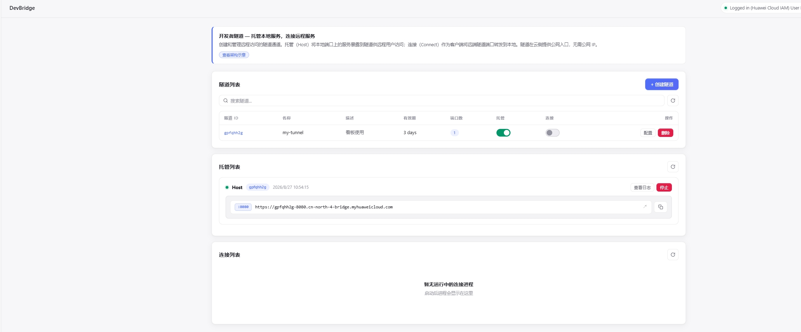

*上图展示了 DevBridge WebUI 界面，可直观查看已创建的隧道列表、状态、公网链接及过期时间，方便管理。*

人工做这件事需要：申请公网 IP、配置安全组放行端口、设置反向代理、处理 HTTPS 证书——步骤多且容易出错。在这里，一句话搞定。

---

## 6. 华为云资源操作：聊天即运维

### 什么是云服务

云服务就是把计算、存储、网络等 IT 基础设施放在华为云的数据中心里，你按需使用、按量付费，不需要自己买服务器、租机房、拉网线。AI 开发者空间把华为云各类资源的查询和操作能力全部内置，你用聊天就能完成日常运维工作，不需要登录华为云控制台手动点选。

华为云控制台主页如下图所示，各类云服务产品入口一览：

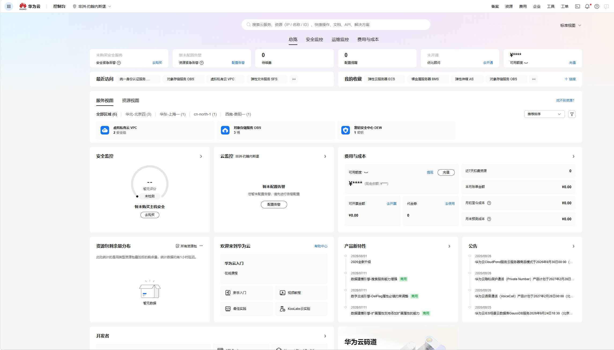

*上图展示了华为云控制台主页，计算、存储、网络、数据库等各类云服务产品入口一目了然。传统方式需要在这里手动点选，而开发者空间用聊天即可完成。*

### 账单与成本查询（示例）

开发者空间不仅支持资源操作，也支持查询账户余额、消费明细和资源包余量。例如，你可以直接说“查一下我的账单”，它会返回余额状态、本月消费、上月对比等关键信息。

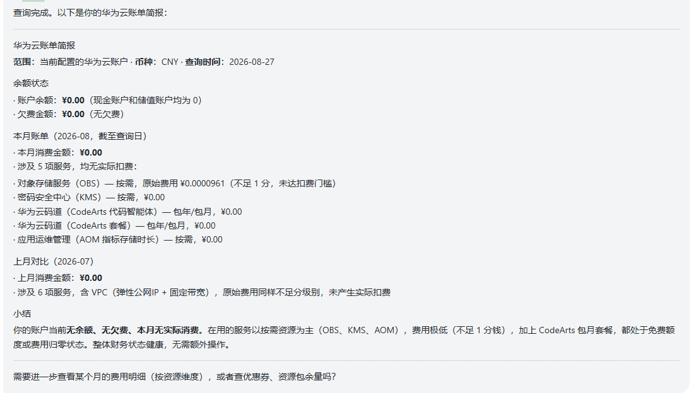

*上图展示了查询账户账单的返回结果，包含余额、消费明细和费用趋势，所有信息一目了然。*

### 计算资源

| 服务名 | 是什么 & 一般用来干啥 |
|--------|---------------------|
| **ECS**（弹性云服务器） | 云上的虚拟机，相当于租了一台远程电脑。用来部署应用、跑脚本、搭环境。开发者空间支持免密 SSH 登录 ECS，自动部署公钥、建立持久连接、用完自动清理密钥 |
| **CCE**（云容器引擎） | 华为云提供的 Kubernetes 集群服务。用来运行容器化应用、管理 Pod 和节点伸缩。开发者空间支持安装 kubectl 和 kubectl-cce 插件，直接用聊天查询集群状态、分析 Pod/Node 的 CPU/内存指标、排查异常 |

### 存储资源

| 服务名 | 是什么 & 一般用来干啥 |
|--------|---------------------|
| **OBS**（对象存储服务） | 云上的文件仓库，类似网盘但面向应用。用来存图片、视频、备份文件、托管静态网站。开发者空间支持创建桶、上传文件/目录、配置静态网站托管、绑定自定义域名 |
| **OBS 静态网站托管** | 把 OBS 桶变成一个能直接通过域名访问的静态网站。上传 HTML/CSS/JS 文件后配置托管，用户通过浏览器就能访问你的网页 |

### 数据库资源

| 服务名 | 是什么 & 一般用来干啥 |
|--------|---------------------|
| **RDS**（关系型数据库服务） | 免运维的云数据库，支持 MySQL、PostgreSQL、SQL Server 等引擎。不用自己装数据库、配主从备份、管磁盘扩容。开发者空间支持查实例列表、分析慢 SQL、巡检健康状态、管理备份恢复、调参数——相当于一个能聊天的 DBA 助手 |

下图演示了如何查询 RDS 实例：开发者空间会自动探测多个区域，返回实例列表（即使为空也能清晰告知结果），并基于结果给出后续建议（例如新建 RDS 并编写后端 API）。

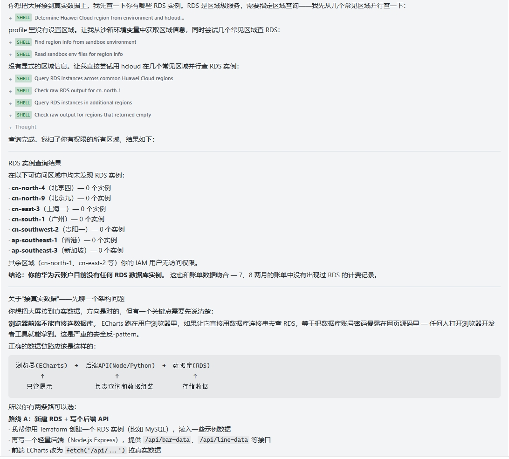

### 网络资源

| 服务名 | 是什么 & 一般用来干啥 |
|--------|---------------------|
| **VPC**（虚拟私有云） | 云上的私有网络，给你的资源划分隔离的网络空间 |
| **EIP**（弹性公网 IP） | 云资源接入互联网的公网 IP，让外部能访问你的服务 |
| **ELB**（弹性负载均衡） | 把流量分发到多台服务器，提升可用性和吞吐量 |
| **NAT 网关** | 让 VPC 内的资源通过同一个公网 IP 访问外网 |
| **DNS**（云解析服务） | 域名解析，把你的域名指向云资源的 IP |

开发者空间支持查询以上全部网络资源的详情、拓扑、安全组规则，不需要去控制台翻菜单。

### 身份与权限

| 服务名 | 是什么 & 一般用来干啥 |
|--------|---------------------|
| **IAM**（身份与访问管理） | 管理谁能访问哪些云资源。查用户/用户组/策略/委托/AK/SK 状态，确认权限配置是否正确 |

### 容器镜像

| 服务名 | 是什么 & 一般用来干啥 |
|--------|---------------------|
| **SWR**（容器镜像服务） | 云上的 Docker 镜像仓库，存和管理容器镜像。企业版支持独立实例、安全扫描、跨实例同步、自定义域名。配合 CCE 使用：镜像推到 SWR，CCE 拉取部署 |

### 基础设施编排

| 能力 | 是什么 & 一般用来干啥 |
|------|---------------------|
| **Terraform 编排** | 用代码描述云资源架构，一键创建/销毁整套基础设施。说一句"帮我用 Terraform 部署一个带 VPC、ECS、EIP 的网站架构"，它自动生成配置文件、校验规格可用性、预估费用、等你确认后执行部署 |

人工操作这些资源需要：登录华为云控制台、在十几个产品页面之间切换、手动填写参数、记住资源 ID 的依赖关系、反复核对规格是否可用。在 AI 开发者空间里，你说一句话，它替你查、替你配、替你执行。

---

## 7. GitCode 版本管理

### 什么是 GitCode

GitCode 是一个代码托管平台，类似于 GitHub，提供 Git 仓库管理、代码审查、协作开发能力。代码放在 GitCode 上，不会因为本地环境丢失而消失，每次修改都有版本记录，团队成员可以协同开发、提交 PR（合并请求）和 Issue（问题跟踪）。

### 开发者空间能做什么

| 操作 | 说明 |
|------|------|
| 扫码登录 | 首次使用时弹出二维码，手机扫码授权，自动获取访问令牌，全程不需要手动输密码 |
| 创建仓库 | 说一句"在 GitCode 帮我建一个叫 xxx 的仓库"，自动创建 |
| 推送代码 | 代码写完后说"帮我推到 GitCode"，自动 git init、add、commit、push |
| 提交 PR | 说"帮我提一个 PR"，自动创建合并请求 |
| 提交 Issue | 说"帮我提一个 Issue 记录这个 bug"，自动创建问题单 |
| 查询仓库 | 查看已有仓库列表、仓库详情 |

**实际登录与授权流程**：当 Token 过期时，开发者空间会自动提示重新授权，并生成二维码或授权链接。你只需扫码或在浏览器中授权，系统便会自动轮询并保存 Token，随后获取用户名并进入确认环节。

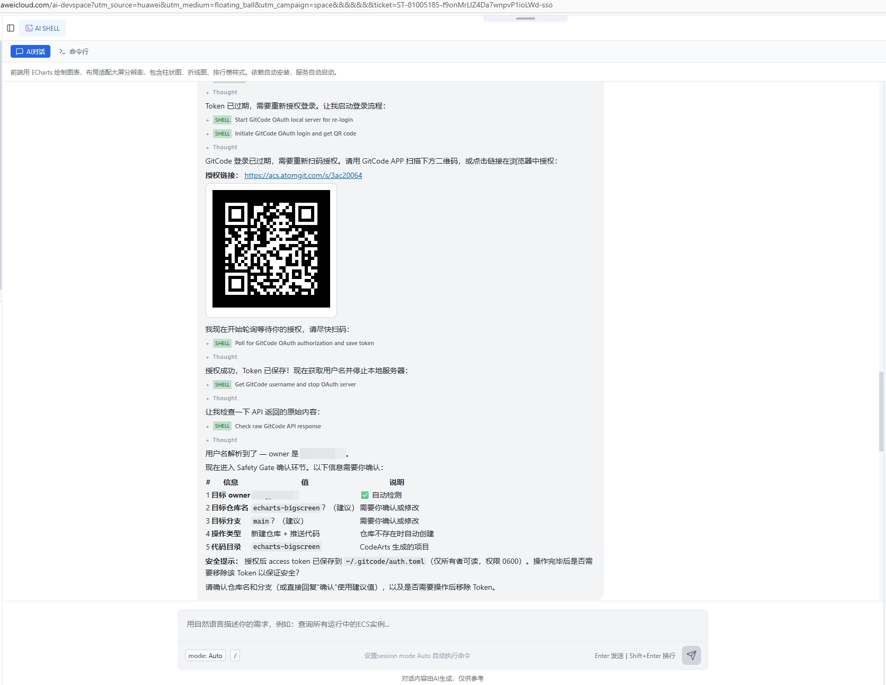

*上图显示了 AI SHELL 中的 GitCode 授权流程：检测到 Token 过期 → 生成授权链接 → 轮询等待授权 → 获取用户名并确认仓库信息。*

每次写操作前，开发者空间都会确认目标仓库和分支信息，避免误操作。操作完成后提醒你是否需要清除本地令牌以保证安全。

人工做这件事需要：打开 GitCode 网页、登录、手动建仓库、在本地配 Git、处理 SSH key、敲 git 命令、再回到网页提 PR。在这里，从登录到推送全程聊天完成。

---

## 8. 完整场景：做一个数据可视化大屏

下面用一个真实场景，展示从第一句话到最终成果的全过程。

**第一步：写代码**

> 你："帮我做一个销售数据可视化大屏，用 ECharts，要展示各区域销售额、月度趋势、Top 10 产品。"

AI 开发者空间自动生成项目代码：前端用 ECharts 绘制图表，布局适配大屏分辨率，包含柱状图、折线图、排行榜样式。依赖自动安装，服务自动启动。

代码编写完成并部署的完整结果如下图所示：

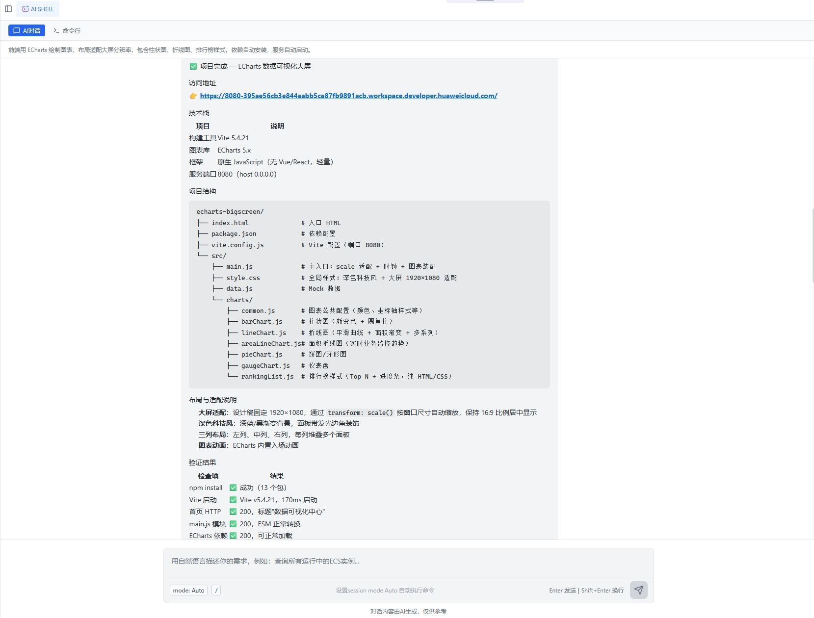

*该图展示了代码编写完成并成功部署的过程，项目结构、依赖安装和服务启动均已就绪。*

**第二步：预览效果**

服务启动后，返回预览链接。你打开浏览器，看到大屏已经渲染出来——图表、配色、布局都已就位。你想调整，直接说"把标题改成'2024 年度销售总览'"，它改代码、重启服务，刷新即更新。

预览效果如下图所示：

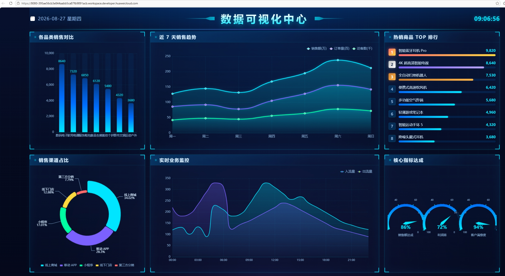

*大屏采用深色科技风、三列布局，包含柱状图、折线图、排行榜、环形图、仪表盘等，适配 1920×1080 分辨率。*

**第三步：接入数据库**

> 你："帮我查一下 RDS 有哪些实例，我想接真实数据。"

开发者空间查询你的 RDS 实例列表，返回实例 ID 和连接信息。接着你说"帮我改一下代码，从 RDS 的 MySQL 数据库读销售数据"，它修改后端代码，配置数据库连接，大屏数据变成实时查询。

**第四步：托管到 OBS**

> 你："帮我把大屏部署到 OBS 静态网站托管。"

开发者空间创建 OBS 桶、上传编译后的静态文件、配置网站托管、绑定自定义域名。部署完成后，通过域名就能直接访问大屏。

在 OBS 管理控制台可以查看托管效果，如下图所示：

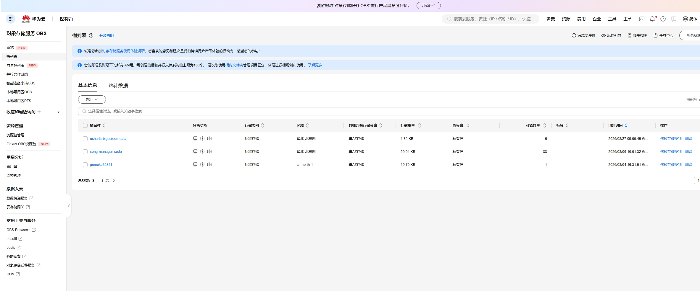

*上图展示了 OBS 管理控制台中的桶状态和静态网站托管配置，文件已上传完毕，可通过域名直接访问。*

**第五步：分享给其他人看**

> 你："帮我创建一个 DevBridge 隧道，把 8080 端口分享出去。"

开发者空间创建隧道，返回公网链接 `https://xxx-8080.cn-north-4-bridge.myhuaweicloud.com`。你把链接发给其他人，对方用手机或电脑打开链接就能看到大屏效果。

**第六步：代码存档**

> 你："帮我把代码传到 GitCode。"

开发者空间弹出 GitCode 扫码登录二维码，你扫码授权后，它自动创建仓库、推送代码。代码永久保存在 GitCode 上，随时可以拉取继续开发。

推送完成后，进入 GitCode 仓库页面即可看到已上传的代码，如下图所示：

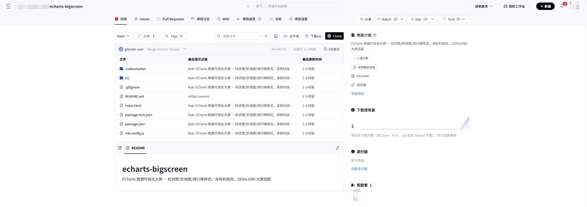

*上图展示了 GitCode 仓库页面，代码已成功推送，包含完整的项目文件和提交记录。*

整个过程：6 步，6 句话。没有打开过任何 IDE，没有敲过一行 git 命令，没有登录过任何云控制台。

---

## 9. 常见问题

**凭证安全吗？**

安全。所有云资源操作使用的是华为云 AK/SK 凭证，存储在环境变量中，不会出现在聊天对话或日志里。GitCode 的访问令牌保存在本地文件（权限 0600，仅所有者可读），操作完成后可一键清除。任何情况下都不会在对话中展示密钥明文。

**需要付费吗？**

AI 开发者空间本身的使用不额外收费。你创建的华为云资源（ECS、OBS、RDS 等）按华为云标准资费计费。DevBridge 隧道有免费额度。详细定价参考华为云价格计算器。

**能开发什么类型的项目？**

支持主流的 Web 前端（React、Vue、HTML/CSS/JS）、后端（Node.js/Express、Python/Flask）、全栈应用、API 服务、数据可视化、静态网站等。只要能用文字描述清楚需求，就能生成对应代码。

**和本地 IDE 有什么区别？**

本地 IDE 需要你自己装环境、配依赖、管版本、处理端口和防火墙。AI 开发者空间把这些全部内置：环境预装好、依赖自动装、端口自动选、预览自动生成、隧道一键开。你专注描述需求，它专注执行。

**需要提前准备什么？**

只需要一个华为云账号和一台能打开浏览器的设备。如果想操作云资源，确保账号下有对应资源的访问权限。如果想用 GitCode，准备好 GitCode 账号用于扫码授权。其他一切，开发者空间替你搞定。
